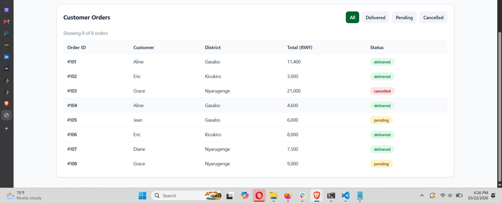

# Week 5: Array & Object Manipulation Drills

## Project Overview

This project is part of the Week 5 JavaScript workshop, focusing on array and object manipulation using a restaurant orders dataset called **Kigali Eats**.

The project includes JavaScript solutions to the workshop exercises and a responsive dashboard that summarizes restaurant performance and allows users to explore orders by status.

**Kigali Eats Dashboard:** [View Live Dashboard](https://week5-array-object-drills.onrender.com)

## Project Structure

- `data.js` — Contains the Kigali Eats restaurant orders dataset.
- `drills.js` — Contains the workshop exercise solutions, numbered in comments.
- `dashboard/` — Contains the Vite application and dashboard source files.
- `screenshots/` — Contains screenshots of the completed dashboard.

## Dashboard Features

- **Performance statistics:** Total revenue from delivered orders, number of delivered orders, average customer rating, and best-selling item.
- **Revenue by district:** Horizontal bars comparing revenue across districts.
- **Orders table:** Displays order ID, customer, district, total price, and order status.
- **Interactive filters:** Filter orders by All, Delivered, Pending, or Cancelled.
- **Responsive layout:** Adapts to desktop and mobile screens.

## Technologies Used

- HTML5
- Tailwind CSS v4
- JavaScript (ES Modules)
- Vite

## Dashboard Screenshots

### Dashboard Overview

.png)

### Customer Orders and Filters

## How to Run Locally

1. Clone the repository.
2. Open a terminal in the project folder.
3. Navigate to the dashboard directory:

   `cd dashboard`

4. Install the dependencies:

   `npm install`

5. Start the development server:

   `npm run dev`

6. Open the local URL displayed in your terminal.

## Score

**My score:** Pending facilitator assessment.

## Author

JavaScript Week 5 Workshop — Kigali Eats Dashboard